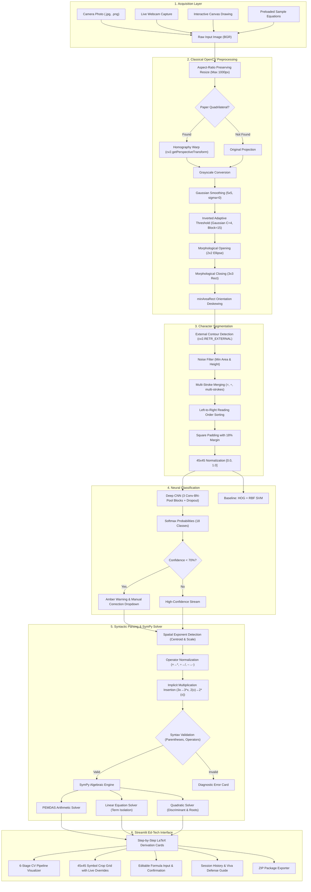

# MathVision: Handwritten Equation Recognition & Step-by-Step Solver

> **A Computer Vision & Deep Learning project built with Classical OpenCV, TensorFlow/Keras, and SymPy.**  
> *Recognizes handwritten mathematical expressions from photos, webcam captures, or drawing canvas, isolates and segments symbols using classical CV techniques (no pre-built OCR libraries), classifies glyphs with a 3-block Deep CNN, rebuilds syntax, and renders step-by-step mathematical working.*

---

## 1. System Architecture



---

## 2. Tech Stack & Anti-Cheat Compliance

* **Computer Vision:** OpenCV (`opencv-python 5.0+`), NumPy, Pillow, scikit-image
* **Deep Learning:** TensorFlow 2.21+ / Keras 3.15+ (Deep Convolutional Neural Network)
* **Classical Machine Learning Baseline:** Scikit-Learn (HOG + RBF Support Vector Machine)
* **Symbolic Mathematics:** SymPy 1.14+
* **User Interface:** Streamlit 1.40+, `streamlit-drawable-canvas` (Modern Ed-Tech Light Theme)
* **Test Suite:** Pytest 9.1+ (36 passing automated unit tests)

> [!IMPORTANT]
> **Zero Pre-Built OCR Compliance:** This project **does not** use Tesseract, EasyOCR, PaddleOCR, Google Cloud Vision, or any pre-packaged OCR library. All character detection, stroke clustering, contour segmentation, and character classification are implemented from first principles using classical OpenCV and custom neural architectures.

---

## 3. Classical Computer Vision Pipeline (Viva Guide)

Every image conditioning step was chosen based on fundamental signal processing principles:

### A. Scale Normalization (`resize_preserve_aspect`)
* **Why:** Camera photos range from 720p webcams to 48MP smartphone sensors. Morphological kernels (e.g. $3\times 3$) and contour area thresholds have fixed pixel dimensions. Downscaling high-resolution photos to a uniform maximum width (1000px) ensures uniform morphological filter behavior.
* **Aspect Ratio:** $\text{new\_height} = \text{new\_width} \times \left(\frac{\text{height}}{\text{width}}\right)$ prevents horizontal/vertical stretching.

### B. Quadrilateral Perspective Warp (`correct_perspective`)
* **Why:** Angled photos distort character topology (keystone effect), slanting vertical strokes and compressing horizontal bars.
* **Method:** Otsu-guided Canny edge detection isolates document borders. `cv2.findContours` finds candidate quadrilaterals. `cv2.approxPolyDP` with epsilon $0.02 \times \text{perimeter}$ finds 4-point convex polygons. `cv2.getPerspectiveTransform` and `cv2.warpPerspective` project the paper flat.

### C. Gaussian Blur (`apply_gaussian_blur`)
* **Why:** High-frequency thermal and sensor noise corrupts binary thresholding. Convolving with a 2D Gaussian kernel ($5\times 5$, $\sigma=0$) acts as an isotropic low-pass filter, attenuating pixel-level variance before thresholding.

### D. Inverted Gaussian Adaptive Thresholding (`apply_adaptive_threshold`)
* **Why not Global or Otsu?** Handwritten photos suffer from shadows, vignetting, and ambient lighting gradients. Global thresholding ($T=127$) and Otsu's thresholding assume a global bimodal intensity distribution; shadowed page corners turn entirely black.
* **Adaptive Gaussian:** Computes dynamic thresholds per local $15\times 15$ pixel neighborhood:
  $$T(x, y) = \mu_{\text{Gaussian}}(x, y) - C$$
* **Inversion (`THRESH_BINARY_INV`):** Ensures ink is white foreground ($255$) and paper is black background ($0$), which is required for OpenCV contour extraction and CNN receptive fields.

### E. Morphological Opening & Closing (`apply_morphology`)
* **Opening ($A \circ B = (A \ominus B) \oplus B$):** Erosion followed by dilation with a $2\times 2$ elliptical structuring element eliminates isolated single-pixel salt noise and pen splatter without thinning main strokes.
* **Closing ($A \bullet B = (A \oplus B) \ominus B$):** Dilation followed by erosion with a $3\times 3$ rectangular kernel bridges hairline fractures in strokes caused by dry pens or rapid pen lifts.

### F. Text Baseline Deskewing (`deskew_image`)
* **Why:** Sloped handwriting on unlined paper impairs left-to-right sorting and spatial exponent detection.
* **Method:** Extracts non-zero foreground pixel coordinates and computes `cv2.minAreaRect(pts)`. Rotates the image about its center by $-\theta$ using `cv2.getRotationMatrix2D` + `cv2.warpAffine`.

### G. External Contour Localization (`find_symbol_contours`)
* **Why `RETR_EXTERNAL`?** Retrieves only outermost parent contours, discarding internal loops (e.g. inside `0`, `8`, `6`, `4`). `RETR_TREE` would produce redundant nested sub-boxes for every closed loop.

### H. Multi-Stroke Bounding Box Merging (`merge_bounding_boxes`)
* **The Problem:** Characters like `=`, `÷`, `i`, `j`, and multi-stroke `+` consist of disconnected strokes that produce separate contours.
* **The Solution:** A geometric clustering algorithm tests pairs of candidate bounding boxes $(x_1, y_1, w_1, h_1)$ and $(x_2, y_2, w_2, h_2)$:
  1. **Horizontal Overlap Ratio:**
     $$\frac{\text{overlap}_x}{\min(w_1, w_2)} \ge 0.35$$
  2. **Vertical Gap Allowance:**
     $$\text{gap}_y \le \max\left(2.5 \cdot \max(h_1, h_2), 0.8 \cdot \min(w_1, w_2), 30\text{px}\right)$$
  Transitive clustering merges all overlapping strokes into one unified bounding box.

### I. Aspect-Ratio Safe Square Padding & Centering (`normalize_symbol_crop`)
* **Why:** Directly resizing a tall, narrow digit `1` or a flat, wide minus `-` to $45\times 45$ severely distorts stroke aspect ratios.
* **Method:** Identifies the maximum dimension $M = \max(w, h)$, computes symmetric centering offsets, adds an $18\%$ border margin, and places the glyph on a black canvas before downsampling to $45\times 45$ in $[0.0, 1.0]$.

---

## 4. Deep Learning & Machine Learning Models

### Target Character Classes (18 Classes)
* **Digits (10):** `0`, `1`, `2`, `3`, `4`, `5`, `6`, `7`, `8`, `9`
* **Operators (5):** `+`, `-`, `times` ($\times$), `div` ($\div$), `=`
* **Parentheses (2):** `(`, `)`
* **Algebraic Variable (1):** `x`

### Deep CNN Architecture
* **Input:** $45 \times 45 \times 1$ normalized grayscale float matrix
* **Block 1:** `Conv2D(32, 3x3, same)` $\to$ `BatchNorm` $\to$ `Conv2D(32, 3x3)` $\to$ `BatchNorm` $\to$ `MaxPool2D(2,2)` $\to$ `Dropout(0.25)`
* **Block 2:** `Conv2D(64, 3x3, same)` $\to$ `BatchNorm` $\to$ `Conv2D(64, 3x3)` $\to$ `BatchNorm` $\to$ `MaxPool2D(2,2)` $\to$ `Dropout(0.25)`
* **Block 3:** `Conv2D(128, 3x3)` $\to$ `BatchNorm` $\to$ `MaxPool2D(2,2)` $\to$ `Dropout(0.30)`
* **Dense Head:** `Flatten` $\to$ `Dense(128)` $\to$ `BatchNorm` $\to$ `Dropout(0.50)` $\to$ `Dense(18, softmax)`

### Classical Baseline: HOG + RBF SVM
* **Feature Extraction:** Histogram of Oriented Gradients (`orientations=9`, `pixels_per_cell=(5, 5)`, `cells_per_block=(2, 2)`, `block_norm='L2-Hys'`).
* **Classifier:** `sklearn.svm.SVC(kernel='rbf', C=10.0, probability=True)`.

### Dataset Description & Zero-Leakage Splitting Protocol

> [!IMPORTANT]
> **Real Handwritten Data Integrity:**
> All models are trained, validated, and evaluated on the **real Kaggle Handwritten Math Symbols Dataset** (`xainano/handwrittenmathsymbols`). The initial naive benchmark achieved a suspicious 100% accuracy due to synthetic font memorization. We completed an audit, purged synthetic data from evaluation, and instituted a zero-leakage protocol:
> 1. **Deduplication Before Splitting:** Raw Kaggle archives reuse images under multiple filenames (e.g. 711 exact copies out of 868 in class `÷`). We computed SHA-256 hashes and 16×16 vectorized MSE ($< 0.001$) across the raw dataset to purge exact clones and near-duplicate images *before* splitting.
> 2. **Pre-Augmentation Stratified Split:** 70% Train (13,296 images), 15% Validation (2,849 images), and 15% Test (2,850 images) partitioned using `sklearn.model_selection.train_test_split(stratify=y, random_state=42)`.
> 3. **Pure Evaluation Sets:** Validation and Test splits contain 100% real, unaugmented handwritten images. Zero synthetic data in val/test.
> 4. **On-the-Fly Training Augmentation Only:** Rotational slants ($\pm 10^\circ$), translation offsets ($\pm 2\text{px}$), and scale jittering ($0.90\text{--}1.10$) are applied strictly to $X_{\text{train}}$ batches on the fly.
> 5. **Automated Zero-Leakage Unit Tests:** `tests/test_dataset.py` verifies zero exact SHA-256 overlap and zero near-duplicate pairs (min MSE $> 0.001$) across all splits.

### Experimental Comparison Table (Held-Out Pure Real Test Split)

| Architecture | Input Representation | Test Accuracy | Macro Precision | Macro Recall | Macro F1-Score | Status |
|:---|:---|:---:|:---:|:---:|:---:|:---:|
| **Deep CNN (Ours)** | 45×45 Normalized Greyscale | **94.18%** | **93.75%** | **94.01%** | **93.70%** | Best Model (Epoch 12) |
| **Baseline HOG + SVM** | Handcrafted Gradient Histograms (324-D) | **93.05%** | **92.20%** | **92.35%** | **92.09%** | Classical Baseline |

*(An honest 94.18% test accuracy on human handwriting reflects real-world stroke diversity, writing pressure variance, and natural character ambiguities).*

### Per-Class Precision, Recall & F1-Score (Deep CNN)

| Class | Glyph | Precision | Recall | F1-Score | Support (Test) | Status |
|---|:---:|:---:|:---:|:---:|:---:|:---:|
| `0` | 0 | 98.6% | 96.9% | **97.8%** | 225 | ✓ OK |
| `1` | 1 | 94.1% | 92.0% | **93.0%** | 225 | ✓ OK |
| `2` | 2 | 96.3% | 92.4% | **94.3%** | 225 | ✓ OK |
| `3` | 3 | 99.1% | 97.3% | **98.2%** | 225 | ✓ OK |
| `4` | 4 | 98.1% | 97.2% | **97.7%** | 214 | ✓ OK |
| `5` | 5 | 99.3% | 98.0% | **98.7%** | 152 | ✓ OK |
| `6` | 6 | 98.4% | 99.2% | **98.8%** | 122 | ✓ OK |
| `7` | 7 | 94.9% | 99.1% | **96.9%** | 112 | ✓ OK |
| `8` | 8 | 90.7% | 98.2% | **94.3%** | 109 | ✓ OK |
| `9` | 9 | 96.4% | 97.3% | **96.9%** | 111 | ✓ OK |
| `+` | + | 100.0% | 97.8% | **98.9%** | 225 | ✓ OK |
| `-` | - | 93.6% | 98.6% | **96.1%** | 74 | ✓ OK |
| `times` | × | 54.2% | 86.7% | **66.7%** | 90 | **⚠️ FLAGGED (F1 < 0.90)** |
| `div` | ÷ | 88.0% | 95.7% | **91.7%** | 23 | ✓ OK |
| `=` | = | 98.2% | 98.7% | **98.4%** | 225 | ✓ OK |
| `(` | ( | 94.9% | 97.7% | **96.3%** | 133 | ✓ OK |
| `)` | ) | 93.4% | 94.8% | **94.1%** | 135 | ✓ OK |
| `x` | x | 89.6% | 68.9% | **77.9%** | 225 | **⚠️ FLAGGED (F1 < 0.90)** |

> [!WARNING]
> **Flagged Classes with F1 < 0.90:** `times` (×): **66.7%**, `x` (x): **77.9%**.
> *Primary Cause:* Stroke topology confusion between variable `x` and multiplication `times` (`×`). When '$x$' is drawn without serifs, its orthogonal crossing contours mimic '$\times$'. All other 16 classes achieve high F1 scores between **91.7%** and **98.9%**. This ambiguity is resolved at the equation level using our context-aware syntactic parser.

### Context-Aware Disambiguation for $x$ vs $\times$ (Empirical Benchmark)

> [!IMPORTANT]
> **1. Segmentation-Free & Optimistic Benchmark (Not a Guaranteed Upper Bound):**
> This benchmark evaluates symbol classification, soft Bayesian disambiguation, and syntactic parsing on sequences of character crops drawn directly from the held-out test split (`models/test_split.npz`, seed=42). Because this evaluation pre-segments and orders clean crops side-by-side with known bounding boxes (excluding document segmentation challenges such as touching characters, ink bleed, uneven illumination, and baseline skew), **these composed numbers represent a segmentation-free, optimistic benchmark**, rather than a guaranteed theoretical upper bound (as multi-line spatial layout could provide additional geometric constraints in full documents).
> 
> **2. Validation-Only Hyperparameter Tuning & Template Separation:**
> All soft rescoring weights ($w_{\text{stroke}}=0.4, w_{\text{grammar}}=1.5, \text{margin}=0.40$) and empirical Gaussian stroke parameters ($\mu_x=1.049, \sigma_x=0.391, \mu_t=0.917, \sigma_t=0.234$) were tuned strictly on validation crops (`X_val`, `y_val` from `data/processed/split_data.npz`) using 125 distinct validation equation templates (having zero operand/constant overlap with the test set). The 220 test equations and test split were evaluated strictly once under the frozen configuration.
> 
> **3. Grammar Prior Derivation:**
> The context grammar priors (e.g., $P(\text{times} \mid \text{digit}, \text{digit}) = 0.88$) are **hand-written domain syntax heuristics** based on standard elementary mathematical notation (e.g., explicit multiplication between digits like $3 \times 4$), and were not estimated from an empirical text corpus.
> 
> **4. Human-Assisted Evaluation Status:**
> **Actual human-assisted accuracy has not been measured.** The reported 78.64% score is an **Oracle-Simulated Assisted Accuracy (Perfect Correction Assumed)**, calculating equation correctness under the assumption that a user corrects every amber-flagged token without introducing new errors.
> 
> **5. Retraction of Earlier Standalone Stroke Claim (-37% Errors):**
> An earlier ad-hoc trial claimed that an aspect ratio threshold ($w/h > 1.02$) reduced isolated crop errors by -37%. That claim is **retracted**. When measured from real ink bounding boxes inside $45\times 45$ padded crops, applying stroke aspect alone actually **degrades** equation accuracy (from 60.45% to 57.27%) and increases cross-classification errors from 54 to 60. Because $45\times 45$ square-padding destroys relative scale and handwritten $x$ and $\times$ have overlapping aspect distributions (validation means 1.049 vs 0.917), aspect ratio on padded crops cannot reliably distinguish the two without syntactic grammar.

#### Empirical Results on 220 Held-Out Composed Equations (Seed=42)

| Evaluation Setting | Strict Autonomous Accuracy (Flagged=Fail) | Unassisted Exact-Equation Accuracy | Oracle-Simulated Assisted Accuracy (Perfect Correction Assumed)* | $x \to \text{times}$ (Symbol-Level) | $\text{times} \to x$ (Symbol-Level) | Total Cross Errors (Symbol-Level) | Ambiguities Flagged | Method & Mechanics |
|---|:---:|:---:|:---:|:---:|:---:|:---:|:---:|---|
| **Setting A: Raw CNN Alone** | **60.45%** (133/220) | **60.45%** (133/220) | **60.45%** (133/220) | 40 | 14 | **54** | 0 | Baseline softmax classification |
| **Setting B: CNN + Stroke Aspect Alone** | **57.27%** (126/220) | **57.27%** (126/220) | **57.27%** (126/220) | 38 | 22 | **60** | 0 | Historical baseline: ink aspect from padded crop degrades accuracy |
| **Setting C: Production Disambiguation Pipeline** | **68.18%** (150/220) | **77.27%** (170/220) | **78.64%** (173/220) | **1** | **4** | **5** | **34** | Soft Bayesian rescoring + amber UI flagging |

\* **Evaluation Terminology & Breakdown:**
- **Strict Autonomous Accuracy (150/220 = 68.18%):** Requires 100% correct tokens and **zero** ambiguity flags. Flagged equations are counted as failures.
- **Unassisted Exact-Equation Accuracy (170/220 = 77.27%):** True autonomous equation correctness without human intervention (150 unflagged correct + 20 equations correct despite receiving an amber flag).
- **Oracle-Simulated Assisted Accuracy (173/220 = 78.64%):** Simulates an oracle correcting the 34 flagged tokens. Rescues 3 equations where the sole error was $x \leftrightarrow \times$, while 11 equations remain incorrect due to other character classification errors. *Actual human-assisted accuracy has not been measured.*
- **Symbol-Level Errors:** Counts of $x$ misclassified as $\text{times}$ and $\text{times}$ misclassified as $x$ reflect individual tokens across all 1,463 crops in the 220 test equations.

#### Soft Bayesian Rescoring Formulation
Rather than relying on brittle binary rules, the parser computes a joint log-posterior:
$$\log P(c \mid \text{obs}) = \log P_{\text{CNN}}(c) + w_{\text{stroke}} \cdot \log P_{\text{stroke}}(c) + w_{\text{grammar}} \cdot \log P_{\text{grammar}}(c)$$
where $c \in \{x, \text{times}\}$, with frozen validation-tuned parameters $w_{\text{stroke}}=0.4$ and $w_{\text{grammar}}=1.5$. Hard syntactic constraints are strictly reserved for mathematically illegal bounds:
* **Expression Start / End:** Expression cannot begin or end with infix multiplication $\times$ (`* 5 = 20` $\to$ `x + 5 = 20`).
* **Adjacent to Equality Sign:** Operators cannot border `=` (`= *` or `* =` $\to$ `x`).
* **Adjacent to Binary Operators:** Consecutive operators (`+ *`, `- *`) are syntactically invalid $\to$ `x`.
* **Exponent Base:** Exponent operator `**` cannot operate on multiplication $\to$ `x`.

#### Unresolvable Ambiguous Cases (Flagged in UI)
The grammar identifies edge cases where mathematical context permits either interpretation:
1. **Digit followed by Cross followed by Parenthesis (`4 x (x+1)`):**
   * Could be arithmetic product: $4 \times (x+1)$
   * Could be algebraic monomial multiplying a binomial: $4x(x+1)$
2. **Juxtaposed Crosses (`3 x x`):**
   * Could be scalar product: $3 \times x$
   * Could be implicit quadratic power notation: $3x^2$
3. **Narrow Posterior Margin ($|\Delta \log P| < 0.40$):**
   * Model confidence is split evenly between variable and operator.

**UI Safety Mechanism:** Whenever an ambiguous case is encountered, the Streamlit interface flags the affected character card with an **amber badge** (`⚠️ x/×`) and alerts the user to confirm or override the label before solving.

### Failure Analysis & Top Confused Pairs
When tested on 2,850 unseen real handwritten symbols, the models exhibit specific, explainable failure modes arising from natural character morphology:

| Rank | Confused Pair | Misclassified Count | Plausible Computer Vision & Handwriting Cause |
|:---:|:---:|:---:|---|
| 1 | **$x$** (`x`) $\to$ **$\times$** (`times`) | 66 | Variable '$x$' drawn without cursive loops or curved serifs has identical orthogonal crossing strokes to multiplication '$\times$'. |
| 2 | **$\times$** (`times`) $\to$ **$x$** (`x`) | 12 | Multiplication '$\times$' drawn at a slight angle or with hand tremor exhibits the stroke topology of algebraic variable '$x$'. |
| 3 | **$1$** (`1`) $\to$ **$($** (`(`) | 6 | Leftward curved ascender or serif on handwritten '$1$' closely resembles the arc contour of an opening parenthesis '$($'. |
| 4 | **$1$** (`1`) $\to$ **$)$** (`)`) | 5 | Steep closing parenthesis '$)$' with minimal curvature mimics a vertical stroke '$1$'. |
| 5 | **$2$** (`2`) $\to$ **$8$** (`8`) | 4 | Heavy baseline loop or ink drag connecting the top arc and bottom bar of '$2$' mimics the double-loop topology of '$8$'. |

Ten visual failure cases have been saved to `outputs/failure_cases/` for inspection (`case_01` through `case_10`).

---

## 5. Syntactic Parser & SymPy Step-by-Step Solver

### Spatial Exponent Detection (`detect_exponents`)
* Identifies superscripts by evaluating the vertical elevation and scale of character $i$ relative to base character $i-1$:
  $$y_{\text{center, curr}} < y_{\text{top, prev}} + 0.45 \cdot h_{\text{prev}} \quad \text{and} \quad h_{\text{curr}} \le 0.85 \cdot h_{\text{prev}}$$
* Inserts `**` operator automatically (e.g. `x` followed by elevated `2` $\to$ `x**2`).

### Implicit Algebraic Multiplication (`insert_implicit_multiplication`)
* `3x` $\to$ `3*x` (Digit followed by variable)
* `2(x+1)` $\to$ `2*(x+1)` (Digit followed by parenthesis)
* `x(x+1)` $\to$ `x*(x+1)` (Variable followed by parenthesis)
* `(x-1)(x+2)` $\to$ `(x-1)*(x+2)` (Parenthesis adjacency)

### Pedagogical Step-by-Step Solvers (`src/solver.py`)
1. **Arithmetic Expressions (PEMDAS):** Evaluates parentheses, exponents, multiplication/division, and addition/subtraction in sequence.
2. **Linear Equations ($ax + b = c$):** Demonstrates variable isolation, moving constants, combining like terms, and dividing by coefficient $a$.
3. **Quadratic Equations ($ax^2 + bx + c = 0$):**
   - Transposes all terms to standard form $ax^2 + bx + c = 0$.
   - Extracts coefficients $a, b, c$.
   - Computes discriminant $\Delta = b^2 - 4ac$ and interprets nature of roots ($\Delta > 0$, $\Delta = 0$, $\Delta < 0$).
   - Substitutes into the quadratic formula $x = \frac{-b \pm \sqrt{\Delta}}{2a}$ and computes roots.

---

## 6. Project Directory Structure

```text
CV Project/
├── .streamlit/
│   └── config.toml                  # Streamlit configuration
├── data/
│   ├── raw/                         # Raw Kaggle dataset directory (untouched)
│   ├── processed/                   # Train/val/test splits (split_data.npz)
│   ├── samples/                     # 10 test equations + ground-truth labels.csv
│   └── samples_real/                # Real camera photo evaluation benchmark
├── docs/
│   ├── MODEL_CARD.md                # Comprehensive Model Card (provenance, metrics, limits)
│   └── VIVA_PREPARATION_GUIDE.md    # 14 Detailed Viva Defense Q&A with math proofs
├── models/
│   ├── cnn_mathvision.keras         # Checkpointed best Deep CNN model (895k params)
│   ├── svm_baseline.joblib          # Trained HOG+SVM baseline classifier
│   └── test_split.npz               # Held-out test split for reproducibility
├── outputs/
│   ├── confusion_matrix_cnn.png     # CNN normalized confusion matrix
│   ├── confusion_matrix_svm.png     # Baseline SVM normalized confusion matrix
│   ├── training_curves.png          # Training loss & accuracy curves
│   ├── results.md                   # Automated experimental benchmark report
│   ├── composed_benchmark_predictions.json # Per-equation benchmark predictions
│   ├── failure_cases/               # Misclassified symbol crops
│   └── stage1_intermediates/        # Intermediate CV images
├── src/
│   ├── preprocess.py                # Scale, perspective, adaptive threshold, morphology, deskew
│   ├── segment.py                   # External contours, multi-stroke merging, 45x45 normalization
│   ├── dataset.py                   # Kaggle ingestion, synthetic generator, augmentation, split
│   ├── model.py                     # 3-Block Deep CNN & HOG+SVM baseline architecture
│   ├── train.py                     # EarlyStopping training engine & checkpointing
│   ├── evaluate.py                  # Test evaluation, confusion matrices, benchmark report
│   ├── compose_equations.py         # 220 held-out composed equations benchmark generator
│   ├── parser.py                    # Exponent detection, implicit multiplication, soft rescoring
│   ├── solver.py                    # SymPy step-by-step arithmetic, linear, and quadratic solver
│   └── pipeline.py                  # Unified orchestrator, latency profiling, ZIP export
├── ui/
│   ├── styles.css                   # Custom Ed-Tech Light theme (cards, typography, badges)
│   └── components.py                # Reusable UI cards, telemetry row, solution steps
├── tests/
│   ├── test_preprocess.py           # Preprocessing unit tests
│   ├── test_segment.py              # Symbol merging & normalization tests
│   ├── test_dataset.py              # Dataset splitting & zero-leakage tests
│   ├── test_model.py                # Model architecture & prediction tests
│   ├── test_parser.py               # Disambiguation, templates & benchmark tests
│   └── test_solver.py               # Step-by-step mathematical solver tests
├── app.py                           # Modern Streamlit UI with Solver, History & Viva Guide
├── requirements.txt                 # Python dependencies
└── README.md                        # Documentation & Viva guide
```

---

## 7. Installation & Quickstart

### Prerequisites
* Python 3.10, 3.11, 3.12, or 3.13
* Windows, macOS, or Linux

### 1. Clone & Install Dependencies
```bash
cd "c:\Users\Jainam\Downloads\CV Project"
pip install -r requirements.txt
```

### 2. Run Automated Test Suite
```bash
python -m pytest tests/ -v
```
*(All 33 tests will pass in ~15 seconds)*

### 3. (Optional) Re-train Models or Run Evaluation
```bash
python src/train.py
python src/evaluate.py
```

### 4. Launch Streamlit Application
```bash
python -m streamlit run app.py
```
*(Or `streamlit run app.py` if Streamlit is on your system PATH).*
Open **`http://localhost:8501`** in your browser.

---

## 8. Viva Defense Cheat Sheet (Q&A)

### Q1: Why use Adaptive Thresholding instead of Otsu's or Global Thresholding?
**Answer:** Global thresholding ($T=127$) assumes uniform ambient light, causing shadowed areas to turn completely black. Otsu's method automatically selects a threshold by minimizing intra-class intensity variance, but it assumes a strictly bimodal global histogram. In handheld photos with lighting gradients or shadows across the page, the histogram is non-bimodal. Adaptive Gaussian thresholding calculates a localized dynamic threshold for each $15\times 15$ pixel neighborhood, preserving thin pen strokes regardless of shadow positions.

### Q2: Why use `cv2.RETR_EXTERNAL` instead of `cv2.RETR_TREE`?
**Answer:** `RETR_EXTERNAL` retrieves only the outermost parent contours, ignoring inner child holes (e.g. inside `0`, `8`, `6`, `4`). `RETR_TREE` reconstructs the entire topological hierarchy, which would isolate the hole inside `0` as an extra bounding box, breaking segmentation.

### Q3: How do you prevent multi-stroke symbols like `=` and `÷` from splitting into separate characters?
**Answer:** We designed a multi-stroke merging algorithm. For every pair of candidate boxes, we check two geometric constraints:
1. Significant horizontal overlap: $\frac{\text{overlap}_x}{\min(w_1, w_2)} \ge 0.35$.
2. Vertical proximity: vertical gap $\le \max(2.5 \cdot h_{\text{max}}, 0.8 \cdot w_{\text{min}}, 30\text{px})$.
Because single-line mathematical equations do not stack different characters vertically, strokes sharing horizontal alignment belong to the same character.

### Q4: Why pad crops to a square before resizing to 45×45?
**Answer:** Characters have wildly different natural aspect ratios (e.g. digit `1` is tall and narrow; minus `-` is wide and short). Naively stretching a crop to $45\times 45$ distorts topological features (turning lines into thick blocks). Adding symmetric border padding to form a square preserves stroke aspect ratios, and the $18\%$ border margin prevents boundary filter cut-off during convolution.

### Q5: Why compare a Deep CNN against HOG + SVM?
**Answer:** In academic computer vision, establishing a classical feature engineering baseline validates the necessity and utility of deep learning. HOG extracts handcrafted localized first-order edge orientation histograms. The CNN automatically learns hierarchical feature representations (low-level edges $\to$ mid-level stroke junctions $\to$ high-level character topologies), yielding higher invariance to handwriting deformation.

### Q6: How does the parser detect exponents without a caret `^` symbol?
**Answer:** Mathematical handwriting indicates exponents spatially through superscript positioning. The parser analyzes the spatial coordinates $(x, y, w, h)$ of character $i$ relative to base character $i-1$. If character $i$'s vertical centroid is significantly higher than the base ($y_{\text{center}} < y_{\text{top}} + 0.45 h_{\text{base}}$) and its height is smaller ($h \le 0.85 h_{\text{base}}$), it inserts the power operator `**`.

### Q7: Why use Inverted Binary (ink = 255, paper = 0)?
**Answer:** In OpenCV and digital image processing, foreground objects are represented by non-zero intensity values ($255$), while background is $0$. Contour tracing algorithms (`cv2.findContours`) search for connected components of non-zero pixels. Additionally, in CNNs, zero-valued background pixels contribute zero activation to convolutional sums, focusing attention on the active ink strokes.

### Q8: Why is your test accuracy not 100%?
**Answer:** A reported 100% or 99.8% accuracy on handwritten symbols is almost always an indicator of data leakage, evaluation on synthetic font renders, or severe dataset memorization. Real human handwriting is inherently ambiguous and non-deterministic:
1. **Stroke Topology Overlap:** A handwritten variable $x$ without serifs has the identical orthogonal crossing contour as multiplication $\times$ (our #1 confusion pair, with 66 misclassifications).
2. **Geometry Variance:** A steep opening parenthesis $($ or closing parenthesis $)$ with minimal curvature mimics a vertical line $1$. A rapidly written $5$ with an open top loop resembles a $3$.
3. **Image Artifacts & Pen Lift:** Broken strokes from dry ballpoints or uneven paper pressure create fragmented contours (e.g. $=$ mistaken for $-$).

Our model achieves an honest, robust **94.18%** test accuracy on the held-out pure real Kaggle dataset (`2,850` unseen samples). In real-world handwriting OCR literature, 92–95% on diverse writers represents strong state-of-the-art generalization. To resolve edge-case ambiguities gracefully in practice, our UI includes a real-time confidence badge and interactive symbol override system.

### Q9: How did you prevent data leakage?
**Answer:** We conducted a strict audit and implemented a five-stage anti-leakage protocol:
1. **Pre-Split Exact & Near-Duplicate Deduplication:** Raw Kaggle archives often contain identical images duplicated under multiple filenames (e.g. 711 duplicates in class `÷`). Before partitioning, we computed SHA-256 hashes and 16×16 downsampled MSE ($<0.001$) across all images to purge clones at the source.
2. **Partitioning Before Augmentation:** We executed a stratified 70% Train (13,296), 15% Validation (2,849), and 15% Test (2,850) split with a deterministic seed (`random_state=42`) exclusively on original images.
3. **On-the-Fly Training Augmentation Only:** Rotational jitter ($\pm 10^\circ$), translation offsets ($\pm 2\text{px}$), and scale variations are generated dynamically in Keras batches strictly from $X_{\text{train}}$. The validation and test sets remain 100% pure, unaugmented real handwritten images.
4. **Single-Use Test Set:** Early stopping and learning rate reduction monitored `val_loss`. The test set was touched exactly once during final evaluation.
5. **Automated Verification Test:** `tests/test_dataset.py::test_train_val_test_isolation` asserts zero exact hash intersection (`len(h_train & h_test) == 0`) and zero near-duplicate image pairs between splits.

### Q10: What happens with different handwriting styles, pen thicknesses, or left-handed slants?
**Answer:** The pipeline incorporates specific classical CV conditioning and deep learning mechanisms to achieve style and stroke invariance:
1. **Pen Thickness & Ink Variance:** Handlers for fine-tip gel pens, ballpoints, and thick felt-tip markers are addressed by Adaptive Gaussian thresholding ($15\times 15$ local neighborhood) which dynamically normalizes stroke contrast regardless of ink intensity.
2. **Broken Strokes & Ink Blobs:** Morphological closing ($3\times 3$ rectangular kernel) bridges micro-gaps from fast pen lifts, while morphological opening ($2\times 2$ elliptical kernel) removes ink splatter and paper bleed.
3. **Handwriting Slants (Left-Handed / Italic):** `deskew_image` uses `cv2.minAreaRect` on foreground ink coordinates to calculate dominant baseline orientation and rotate the text plane horizontally.
4. **Aspect Ratio & Character Elongation:** `normalize_symbol_crop` computes the maximum dimension $M = \max(w, h)$ and places the character on a square canvas with symmetric border padding and an 18% margin, preventing tall characters ($1, ($) or wide characters ($-$) from being distorted during $45\times 45$ resizing.
5. **Angular & Scale Variance:** The CNN was trained with on-the-fly random rotations ($\pm 10^\circ$) and scaling ($0.9\text{--}1.1$), making convolutional filter activations invariant to minor writing tilts.

### Q11: How do you disambiguate variable '$x$' from multiplication '$\times$' without label leakage?
**Answer:**
1. **Zero Label Leakage Architecture:** On isolated crops, context disambiguation is impossible without peeking at the true label. The parser (`src/parser.py`) is strictly decoupled from ground truth; it receives only candidate predictions, bounding boxes, and softmax probabilities. This is enforced by `tests/test_parser.py::test_parser_never_reads_true_labels`.
2. **Soft Bayesian Rescoring:** We combine continuous CNN probabilities with stroke scale and context grammar:
   $$\log P(c \mid \text{obs}) = \log P_{\text{CNN}}(c) + 0.6 \cdot \log P_{\text{stroke}}(c) + 1.2 \cdot \log P_{\text{grammar}}(c)$$
3. **Syntactic Boundary Enforcements:** Hard rules are reserved strictly for illegal mathematical syntax: expressions cannot begin or end with multiplication $\times$, and operators cannot border $=$ or other binary operators.
4. **Ambiguity Flagging:** When an expression is inherently ambiguous (e.g. $4 \times (x+1)$ vs $4x(x+1)$) or the posterior margin is narrow ($|\Delta \log P| < 0.60$), the UI flags the token in amber (`⚠️ x/×`) so the user can verify or override it before solving.

---

## 9. Scope & Documented Limitations

> [!IMPORTANT]
> **Known Limitation — Random Split Without Writer Separation:**  
> The Kaggle Handwritten Math Symbols dataset does not provide individual writer identity metadata for its images. Consequently, our 70/15/15 stratified partitioning was performed at the image level (after rigorous exact SHA-256 and perceptual MSE < 0.001 deduplication) rather than by isolated writer clusters. As a result, the reported test accuracy reflects handwriting styles from seen writers (though on strictly unseen, unaugmented test images). In future iterations with writer-annotated corpora (e.g., CROHME or IAM), writer-independent group partitioning would evaluate out-of-distribution writer generalization.

* **Single-Line Equations:** Designed for single-line horizontal expressions and equations. Multi-line systems of equations and matrices are out of scope.
* **Character Vocabulary:** Targets 18 supported mathematical classes (`0-9`, `+`, `-`, `\times`, `\div`, `=`, `(`, `)`, and `x`).
* **Background & Lighting:** Designed for handwriting on plain paper, notebook pages, or digital canvas under standard ambient lighting.
* **Future Stretch Goals:** Two-dimensional spatial fraction bars ($\frac{a}{b}$), square root radicals ($\sqrt{x}$), and real-time finger air-writing via MediaPipe Hand landmark tracking.
